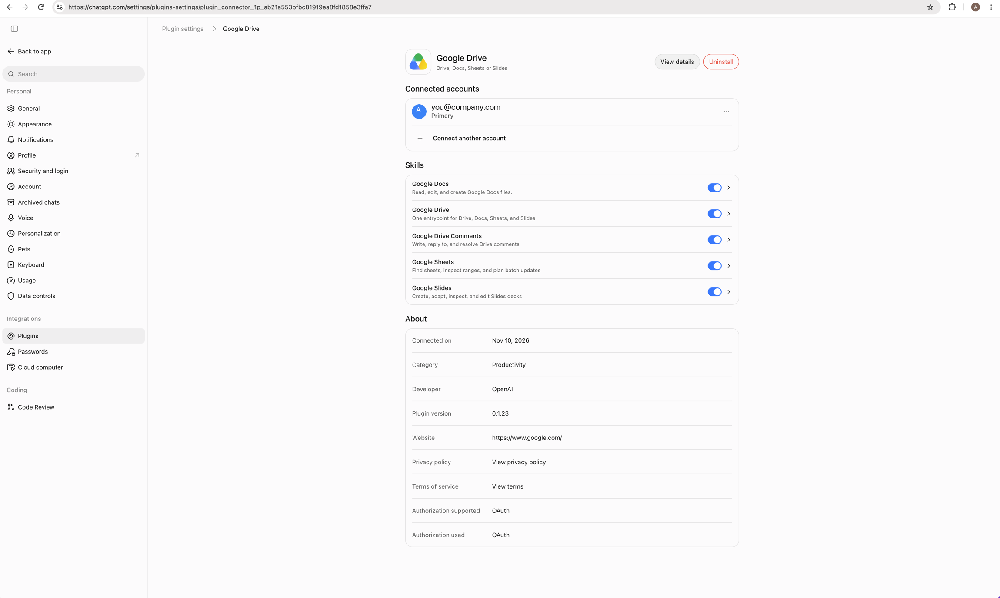

# omp-gdrive

An OMP plugin that reaches Google Drive, Docs, Sheets, and Slides through the **ChatGPT Google Drive app**. It signs in to ChatGPT with its own OAuth login and talks to the ChatGPT apps MCP gateway (`https://chatgpt.com/backend-api/ps/mcp`). Every Drive operation, read or write, goes through one discoverable `xd://gdrive` device, and a read-only `gdrive://` URL scheme exposes Drive to OMP's `read`, `glob`, and `grep` tools. You don't create a Google Cloud project or OAuth client.

## Install

```sh
omp plugin install github:anatoli-tsinovoy/omp-gdrive
```

OMP accepts `github:user/repo` plugin sources. Restart OMP if the current session does not discover the plugin. Requires OMP 18.18.1 or newer.

## Setup

### 1. Install Google Drive in ChatGPT

1. Sign in at [chatgpt.com](https://chatgpt.com) with the account and ChatGPT workspace that should reach Drive. For a work Drive, use your work ChatGPT workspace.
2. Open **Settings → Plugins**, choose **Google Drive**, and connect your Google account. Your ChatGPT workspace admin may need to enable the app first.



### 2. Sign in from OMP

Run `/gdrive login` in OMP.

Like OMP's own `/login openai-codex`, it opens a sign-in dialog and tries to open your browser. The dialog shows:

- the full ChatGPT authorization URL
- a local shortcut, `http://localhost:1455/launch`, which works on this machine only
- a paste field

Pick the same account and ChatGPT workspace as in step 1.

When OMP runs on the same machine as the browser, the callback on port 1455 finishes sign-in without a paste.

On a headless or remote host (SSH, containers):

1. Open the full authorization URL in a browser on any machine.
2. After you sign in, the browser lands on `http://localhost:1455/auth/callback?code=…`, which won't load.
3. Copy that whole URL from the address bar and paste it into the dialog. The authorization code alone also works.

Other commands:

- `/gdrive status` shows the signed-in ChatGPT account and the Google account the app reaches.
- `/gdrive logout` deletes the plugin's login.

## Credentials

- The login is stored only in `~/.omp/agent/omp-gdrive/chatgpt-auth.json`, or in `chatgpt-auth.<profile>.json` under a non-default OMP profile. The directory is mode `0700` and the file `0600`.
- It is separate from OMP's own logins and from other plugins' logins. `/login openai-codex` and OMP's auth database are neither read nor changed, so the plugin can use a different ChatGPT workspace than your model provider.
- The access token is refreshed with the stored refresh token before it expires, and again after a `401` from the gateway. Neither case needs a new browser sign-in. Concurrent OMP processes pick up each other's rotated tokens from the file.
- A refresh that returns a different ChatGPT workspace is rejected; run `/gdrive login` again to switch.

## Use

Every Drive operation goes through the `xd://gdrive` device: `write` JSON to it. `read xd://gdrive` shows its usage.

Reads have their own ops. `file` takes a file ID or any Drive, Docs, Sheets, or Slides URL. `folder` takes an ID, a URL, `root` for My Drive, or a shared drive's name.

```json
{"op":"search","query":"roadmap","kind":"doc","limit":10}
{"op":"search","kind":"sheet","filter":"modifiedTime > '2026-11-01T00:00:00'"}
{"op":"recent","limit":10}
{"op":"drives"}
{"op":"list","folder":"Team Shared Drive"}
{"op":"read","file":"1AbC…"}
{"op":"sheet","file":"1AbC…"}
{"op":"sheet","file":"1AbC…","range":"'Q1 Plan'!A1:F50"}
{"op":"slides","file":"https://docs.google.com/presentation/d/1AbC…/edit"}
{"op":"info","file":"1AbC…"}
{"op":"comments","file":"1AbC…"}
{"op":"profile"}
```

- **Opening items:** every listed file or folder ends with the exact op that opens it: `read` for documents, PDFs, and other files, `sheet` for spreadsheets, `slides` for decks, and `list` for folders.
- **Search filters:** `kind` restricts results to `doc`, `sheet`, `slides`, `pdf`, `folder`, or `image`. `filter` adds a raw Drive v3 `q` expression, ANDed with `kind`. `viewed:true` keeps only files you have opened.
- **IDs:** `read` and `list` accept bare IDs, which the app's own tools reject; the plugin turns them into Drive URLs.
- **Long files:** `read` returns about 30,000 characters at a time and ends with the exact `offset` op that continues.
- **Spreadsheets:** `sheet` without `range` lists the tabs with their sizes and a ready range op for each. With `range`, it returns cell values as TSV.
- **Decks:** `slides` outlines a deck with each slide's `objectId`, which `batch_update_presentation` edits need.
- **Metadata and comments:** `info` shows metadata, parent folders, and who has access. `comments` shows quoted text, resolution state, replies, and a `page` op when more exist.

Any other Drive app tool is called directly:

```json
{"op":"tools"}
{"op":"schema","tool":"batch_update_document"}
{"tool":"batch_update_document","args":{"document_url":"1AbC…","requests":[{"replaceAllText":{"containsText":{"text":"Q3","matchCase":true},"replaceText":"Q4"}}]}}
{"op":"login"}
```

- `op` defaults to `call`. Tool names drop the gateway's `google_drive.` prefix; the prefixed form also works.
- No gateway connection opens until Drive is first used. No Drive tool schemas enter the model's context at load: `tools` lists only names, and each schema arrives only through its own `schema` op.
- Approval tiers:
  - `read`: the read ops, `tools`, `schema`, and calls to the app's read-only tools (`get_*`, `list_*`, `search*`, `fetch*`, `find_*`, `recent_documents`, `export_file`). This set matches the app's `readOnlyHint` exactly (29 of 45 tools).
  - `write`: batch updates, comments, create, copy, import, upload, update/move, share, delete, and `login`.
  - Tools from other ChatGPT connectors are never listed or callable.

Confirm with the user before editing, commenting on, creating, moving, sharing, or deleting files, unless they asked for that exact action.

## `gdrive://` files

OMP's `read`, `glob`, and `grep` tools also see Drive as a read-only tree of files:

| URL | Reads as |
| --- | --- |
| `gdrive://` | My Drive and the shared drives |
| `gdrive://My Drive/Projects/` | a folder listing; shared drives go by name: `gdrive://Team Drive/…` |
| `gdrive://My Drive/Projects/Q3 plan.gdoc` | the file's text; `:N-M` selects lines |
| `gdrive://id/<id>[/names…]` | any file or folder by id, with names continuing below a folder |
| `gdrive://search?q=roadmap&kind=doc&limit=10` | search results, each with its `gdrive://id/…` URL; also takes `filter` and `viewed` |

```text
read  gdrive://My Drive/
glob  gdrive://My Drive/**/*.gsheet
grep  "launch date" gdrive://id/1AbC…/
```

- **Names** follow Drive for desktop: Docs, Sheets, Slides, Forms, and Drawings end in `.gdoc`, `.gsheet`, `.gslides`, `.gform`, `.gdraw`. A `/` in a title becomes `_`. Titles that collide within a folder, ignoring case, carry `~<id>` before the extension. Lookups match exactly first, then by a unique case-insensitive match.
- **Content:** a `.gsheet` reads as every tab, each under a `## Tab` heading with its full grid as TSV. Images, audio, video, and shortcuts read as a one-line note with their link instead of being fetched. Everything else is the app's `fetch` text.
- **Folders** list at most 1,000 items; the app's `list_folder` has no paging.
- **Caching:** listings and texts are kept for 60 seconds, so a `grep` retried after OMP's 30-second grep timeout continues from where it stopped.
- **Cost:** `grep` fetches every file under its path, and each fetch can show up in the file owner's audit log. Scope it to a folder, or find files with `gdrive://search` first. `glob` needs only folder listings.
- **Read-only:** OMP refuses `write` and `edit` on `gdrive://`; changes go through `xd://gdrive`. The scheme is registered while an OMP session is running, and loading fails if another plugin already owns `gdrive://`.

## Included prompts

Bundled skill: `google-drive`. It covers finding and reading files, and confirmed edits through the Docs, Sheets, and Slides `batchUpdate` tools.
